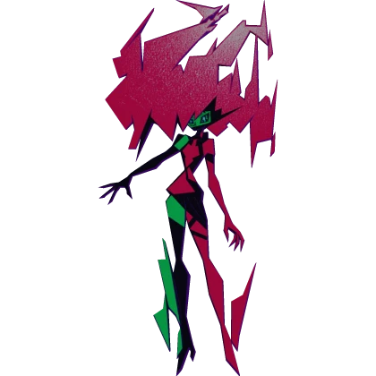

<table>
<tr>
<td width="50%" align="center"></td>
<td width="50%" align="center"></td>
</tr>
</table>

Bring Capri (back lol) to life as a desktop companion! Inspired by jpartnma_'s tiktok video.

Beware that Capri may try to take over your human CPU. We take no responsibility for her actions.

To download it just click on the release in the right hand corner and click capri-setup.exe!

Have fun and more updates to come!
