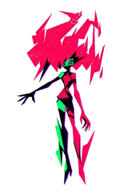
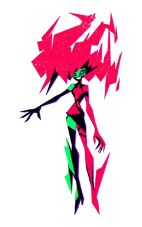
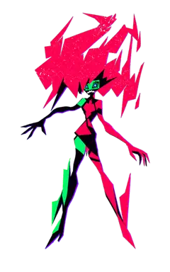
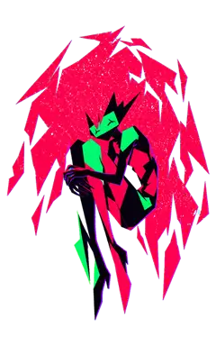
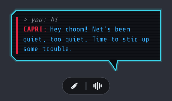
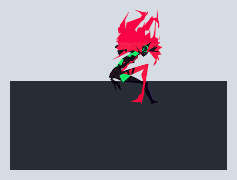
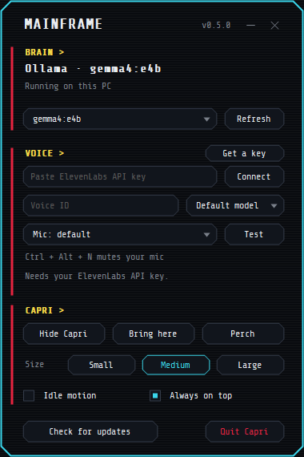

  
  

  Bring Capri (back lol) to life as a desktop companion! Inspired by jpartnma_'s tiktok video.

  <a href="https://github.com/yerocsin42/capri-desktop/releases/latest/download/Capri-Setup.exe"><b>Download for Windows</b></a>

<table align="center">
  <tr>
    <td align="center"> Hanging out</td>
    <td align="center"> Talking</td>
    <td align="center"> Getting tossed</td>
    <td align="center"> Glitching</td>
    <td align="center"> Napping</td>
  </tr>
</table>

Beware that Capri may try to take over your human CPU. We take no responsibility for her actions.

## What she does

- **Talks back.** Type to her and she answers in her own words.
- **Talks out loud.** Add an ElevenLabs key and she speaks, or voice chat with her.
- **Does things for you.** Ask her to open apps, play music or close a tab.
- **Watches you play.** Turn it on and she comments on your games.
- **Sits on your stuff.** Drop her on a window, an icon or the bottom of your screen.

  
  
  

## What you need

- Windows 10 or 11 (64-bit). Nothing else to install.
- A mic, if you want to voice chat.

| | Brain on your PC | Brain from a key (like the free NVIDIA one) |
| --- | --- | --- |
| Memory | 8 GB, 16 GB is better | 4 GB |
| Graphics card | Optional, but 4 GB or more makes her faster | Not needed |
| Space | 3 to 5 GB | Under 100 MB |
| Internet | Only for the download | Always |

## Getting started

1. Download **Capri-Setup.exe** and run it
2. In the Capri Mainframe, press **Set up her brain**, or press **Free key** to use a free NVIDIA key
3. Optional: paste an ElevenLabs key so she can talk

Windows or your antivirus may warn you because it's a new app. All the code is here.

## How to use her

- **Pencil:** type to her
- **Wave:** voice chat
- **Drag her:** sit her on a window
- **Right-click her** or the tray icon: menu and settings

Just ask her for things, like "open Spotify", "play Blinding Lights", "pause", "what's playing?" or "close Discord".

All controls

| Control | What it does |
| --- | --- |
| Shift + drop | sit her right where you drop her |
| Ctrl + drop | she hangs on; click her to let go |
| Mic button | mute your mic in voice chat |
| Ctrl + Alt + V | start or stop voice chat |
| Ctrl + Alt + N | mute your mic |
| Ctrl + Alt + C | get her off your cursor |
| Right-click, Move | she hops between your open windows |
| Watch my screen | in the Mainframe: she comments as you play |
| Speak replies | in the Mainframe: turn off to save ElevenLabs credits |

## Coming up

- Working with your files: open, read and edit the ones you pick
- Controlling YouTube and your apps: skip, fullscreen, click, type and scroll
- A free voice that runs on your PC
- Remembering things about you
- Looking things up and telling you the answer
- Her own cursor that she moves around your screen
- Head pats (smh)
- Mischief mode: screen glitches, stealing your cursor, "you've been hacked" notes
- Mac and Linux

## Licence

Free for anything non-commercial: use her, share her, change her. No selling her or putting her in paid products. Full terms in [LICENSE.md](LICENSE.md) (PolyForm Noncommercial 1.0.0).

Have fun and more updates to come!

Setup guide based on Dancer's guide in the Discord. Font: Share Tech Mono (OFL).
